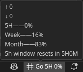

# Features / 功能

Basic setup lives in [README.md](README.md); all settings are documented in [CONFIG.md](CONFIG.md).

基本使用见 [README.md](README.md)，全部配置项见 [CONFIG.md](CONFIG.md)。

[English](#english) | [中文](#中文)

## English

### Status Bar: Plan Usage & Token Indicator

The status bar shows your OpenCode Go plan usage for the current 5-hour window (e.g. `Go 5H 65%`, or `Go --` before the first fetch). Hover the status bar item to see:

- **Plan usage**: 5-hour / weekly / monthly utilization and the 5-hour window reset countdown.
- **Token usage**: cumulative input/output token counts, plus the cumulative cache hit count and cache hit rate for models that return cache metrics in an OpenAI-compatible format.

Click the status bar item or run `OpenCodeGo: Check OpenCode Go Usage` to refresh immediately. The tooltip usage section and the background refresh interval are controlled by `opencodego.showUsageInTooltip` (default `true`) and `opencodego.usageRefreshInterval` (default 5 minutes). The advanced token indicator can be disabled with `opencodego.enableThirdPartyTokenIndicator` (default `true`); the native Copilot token indicator always stays visible.

> **Note**: Whether a model displays cache data depends on whether its API returns cache metrics in an OpenAI-compatible format. This does not indicate whether the model supports caching — caching support depends on OpenCode Go.

### Git Commit Messages

Click the **magic wand** button in the Source Control (SCM) panel to auto-generate a commit message.

You can configure the model, language, number of recent commits to reference, and whether to attach context files. The button can be hidden with `opencodego.enableCommitGeneration` (default `true`).

### Model Temperature Presets

Quickly switch temperature presets via `Ctrl+Shift+P` → `OpenCodeGo: Set Model Temperature Preset`.

Built-in presets (the default is `default`):

| Preset | Temperature |
|--------|-------------|
| Default | _not sent_ (model default) |
| Precise | 0.0 |
| Balanced | 1.0 |
| Creative | 1.2 |
| Extra Creative | 1.7 |

The `default` preset sends neither `temperature` nor `top_p`, so every model keeps its own provider default — matching OpenCode, which no longer sends a temperature. Pick another preset only when you want to override it.

You can also configure `opencodego.temperature` and `opencodego.top_p` directly in `settings.json` (requires `opencodego.modelPreset` set to `"custom"`).

### Extended Vision Understanding

This extension adds **extended vision understanding** capability to **text-only models** that do not natively support vision. When you send a message with an image to these models, they can call a vision-capable model to describe the image, and then answer based on that description.

You can configure the default vision model and whether to enable thinking when describing images. The default value `qwen-plus-latest` automatically selects the newest `qwen*-plus` model from the models.dev catalog.

### Model Catalog & Auto Discovery

The model list is driven by the [models.dev](https://models.dev) catalog. Protocol, context length, vision, reasoning options and endpoints are resolved automatically from adapter metadata, so new models appear without an extension update.

- `opencodego.enableAutoModelDiscovery` (default `true`) filters the picker to models actually available on the API; disable it to list every catalog model.
- `opencodego.showDeprecatedModels` (default `false`) reveals models marked as deprecated in the catalog.
- `opencodego.modelsDevUpdateInterval` (default `60000` ms) sets how often model updates are checked.
- Run `OpenCodeGo: Update OpenCode Go Model List (forced)` to refresh the list manually.

### Proxy / Gateway (Advanced)

Advanced users can route inference requests (chat and Git commit message generation) through a self-hosted proxy/gateway for observability, key routing or compression. Run `OpenCodeGo: Set Proxy Base URL` and acknowledge the compatibility notice; the proxy must be fully compatible with the official endpoint (same protocols, paths, model IDs and headers, and unmodified streaming responses). Usage and model list requests always use the official endpoint. Leave the value empty to disable.

## 中文

### 状态栏：套餐用量与 Token 指示器

状态栏显示 OpenCode Go 套餐当前 5 小时窗口的用量（如 `Go 5H 65%`，首次获取前显示 `Go --`）。悬停状态栏条目可查看：

- **套餐用量**：5 小时 / 周 / 月三个窗口的使用率与 5 小时窗口的重置倒计时。
- **Token 用量**：累计输入/输出 Token 量；当模型接口以 OpenAI 兼容格式返回缓存数据时，还会显示**累计缓存命中量**与**缓存命中率**。

点击状态栏条目或运行 `OpenCodeGo: 查询 OpenCode Go 用量` 命令可立即刷新。tooltip 中的用量区块与后台刷新间隔由 `opencodego.showUsageInTooltip`（默认开启）和 `opencodego.usageRefreshInterval`（默认 5 分钟）控制。可通过 `opencodego.enableThirdPartyTokenIndicator`（默认开启）关闭高级 Token 指示器；Copilot 原生 Token 指示器不受影响。

> **注**：模型是否显示缓存数据取决于其接口是否通过 OpenAI 兼容格式返回缓存数据，这并不代表该模型是否支持缓存。缓存支持情况取决于 OpenCode Go。

### Git 提交消息

在源代码管理（SCM）面板中点击魔法棒按钮，自动生成 Git 提交消息。

可在配置里配置使用的模型、语言、参考的最近提交数量以及是否附加上下文文件。可通过 `opencodego.enableCommitGeneration`（默认开启）隐藏该按钮。

### 模型温度预设

通过 `Ctrl+Shift+P` → `OpenCodeGo: 设置模型温度预设` 快速切换温度预设。

内置预设档位（默认使用「默认」）：

| 档位 | 温度 |
|------|------|
| 默认 | _不发送_（由模型自行决定） |
| 精确 | 0.0 |
| 均衡 | 1.0 |
| 创意 | 1.2 |
| 极具创意 | 1.7 |

「默认」档位不发送 `temperature` 与 `top_p`，各模型沿用自身上游默认值，与 OpenCode 不再主动发送温度的行为一致。只有在需要覆盖模型默认值时才选择其他档位。

也可在 `settings.json` 中直接配置 `opencodego.temperature` 和 `opencodego.top_p`（需将 `opencodego.modelPreset` 设为 `"custom"`）。

### 扩展视觉理解

本扩展为**不支持视觉理解**的**纯文本模型**添加了**扩展视觉理解**功能，当你向这些模型发送带有图片的信息时，他们可以调用支持视觉理解的模型为图片输出描述，然后再回答。

通过配置文件可更改默认使用的模型以及是否在描述图片时启用思考。默认值 `qwen-plus-latest` 会自动选择 models.dev 目录中最新的 `qwen*-plus` 模型。

### 模型目录与自动发现

模型列表由 [models.dev](https://models.dev) 目录驱动，协议、上下文长度、视觉能力、思考档位与端点等元数据均自动从适配器信息解析，新模型无需更新扩展即可出现。

- `opencodego.enableAutoModelDiscovery`（默认开启）会按 API 实际可用的模型过滤选择器；关闭后显示目录中的全部模型。
- `opencodego.showDeprecatedModels`（默认关闭）显示目录中标记为已弃用的模型。
- `opencodego.modelsDevUpdateInterval`（默认 `60000` 毫秒）控制模型更新检查的缓存间隔。
- 运行 `OpenCodeGo: 更新 OpenCode Go 模型列表 (强制)` 命令可手动刷新。

### 代理 / 网关（高级）

高级用户可将推理请求（聊天与 Git 提交消息生成）通过自建代理/网关转发，用于可观测性、多 Key 路由或压缩等场景。运行 `OpenCodeGo: 设置代理 Base URL` 命令并确认兼容性提示即可配置；代理必须与官方端点完全兼容（协议、路径、模型 ID、请求头一致，且不得改写流式响应）。用量查询与模型列表请求始终访问官方地址，留空可禁用。
