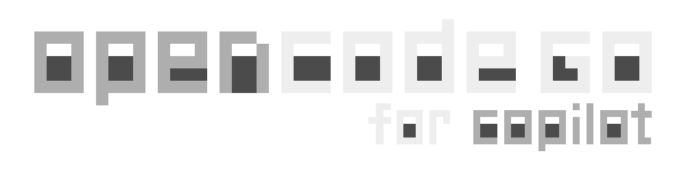
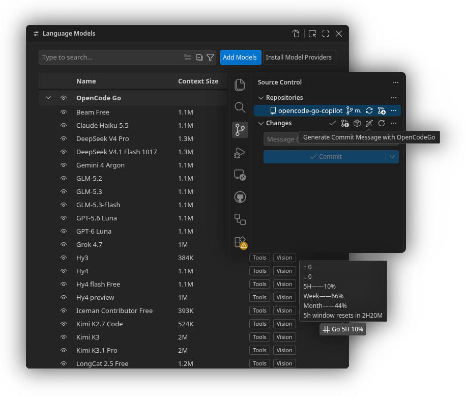

<div align="center">



An extension that brings the models provided by [OpenCode Go](https://opencode.ai/go) into VS Code's integrated agent (e.g. Copilot Chat).

将 [OpenCode Go](https://opencode.ai/go) 提供的模型接入 VS Code 集成 Agent（例如 Copilot Chat）的扩展。

[](https://marketplace.visualstudio.com/items?itemName=OnesoftQwQ.opencode-go-copilot-provider)
[](https://marketplace.visualstudio.com/items?itemName=OnesoftQwQ.opencode-go-copilot-provider)
[](https://marketplace.visualstudio.com/items?itemName=OnesoftQwQ.opencode-go-copilot-provider)
[](https://marketplace.visualstudio.com/items?itemName=OnesoftQwQ.opencode-go-copilot-provider)



</div>

## Disclaimer / 声明

This is not affiliated with, officially maintained by, or endorsed by OpenCode or Anomaly.

本扩展与 OpenCode 官方或 Anomaly 无关，也未获得其官方维护或认可。

## Usage / 使用

<ol>
  <li>Set API Key: <code>Ctrl+Shift+P</code> → <code>OpenCodeGo: Set OpenCode Go API Key</code></li>
  <li>Show Models: Click the settings icon in the model picker → Language Models panel → set your desired models to Visible</li>
  <li>Select Model: In the Copilot Chat bottom model picker, choose an "OpenCode Go" model</li>
  <li>Start chatting</li>
</ol>

<ol>
  <li>设置 API Key：<code>Ctrl+Shift+P</code> → <code>OpenCodeGo: 设置 OpenCode Go API 密钥</code></li>
  <li>显示模型：在模型选择器中点击设置图标 → 语言模型 面板 → 将需要使用的模型显示</li>
  <li>选择模型：在 Copilot Chat 底部模型选择器中选择 "OpenCode Go" 下的模型</li>
  <li>开始对话</li>
</ol>

## Features / 功能

Once the extension is installed and configured, the status bar shows your plan usage and the token usage of the current request.

插件安装并配置后，你的状态栏将会显示套餐用量以及当前请求 Token 用量。

You can click the magic wand icon in the Source Control panel to generate commit messages for the current workspace changes. The default model is `deepseek-v4-flash`.

你可以在源代码管理面板中点击魔棒图标，为当前工作区更改生成 Commit 信息。默认使用模型为 `deepseek-v4-flash`。

More features:

更多功能：

<ul>
  <li>Switchable model temperature presets</li>
  <li>Extended vision understanding for text-only models</li>
  <li>Model catalog from models.dev with auto discovery</li>
  <li>Proxy/gateway support for inference requests (advanced)</li>
</ul>

<ul>
  <li>可切换的模型温度预设</li>
  <li>为纯文本模型提供扩展视觉理解</li>
  <li>基于 models.dev 的模型目录与自动发现</li>
  <li>支持通过代理/网关转发推理请求（高级）</li>
</ul>

See [ADVANCED_FEATURES.md](/ADVANCED_FEATURES.md) for an introduction and usage guide to these features.

这些功能的介绍以及使用教程可见 [ADVANCED_FEATURES.md](/ADVANCED_FEATURES.md)

## Configuration / 配置

All available settings are documented in [CONFIG.md](CONFIG.md).

全部可用配置见 [CONFIG.md](CONFIG.md)。

## Build / 编译

```bash
npm install
npm run compile
npm test           # runs the test scripts / 运行测试脚本
npm run build      # packages extension.vsix / 打包为 extension.vsix
```

## License / 协议

MIT License. This project references code from [oai-compatible-copilot](https://github.com/JohnnyZ93/oai-compatible-copilot).

MIT License。本项目参考了 [oai-compatible-copilot](https://github.com/JohnnyZ93/oai-compatible-copilot) 的代码。
